<div align="center">



### Prove you're human. Make it fun.

**A narrated fairytale where every gate is a CAPTCHA, and the only way through is being gloriously human.**


*Built for Pixathon by Insight AI, problem statement 01: **Reimagine CAPTCHA**.*

</div>

---

## The story in 30 seconds

In the kingdom of **MIT-WPU**, a prince and princess meet under a cherry blossom tree. King Rudra forbids the match. One moonless night a hooded figure kidnaps the princess and leaves a note: *"Solve the three trials and find me."*

The player types **their own name and their partner's name**, and the tale stars them. They cross three trials to get their loved one back, and discover at the end that the hooded kidnapper was **CAPT. CHA**, the royal CAPTCHA, who only wanted to find one truly human heart.

<div align="center">

</div>

| Act | What happens | Mechanic |
| --- | --- | --- |
| **Intro** | Seven narrated, painted scenes. Names are typed in once and woven into the captions. | Cinematic with word-by-word captions |
| **Trial 1: Forest of Clues** | The trees watch you back. | Observation puzzles, 7 challenge types |
| **Trial 2: Bridge of Insight** | Every plank is a riddle. | Cows & Bulls, a four-letter word deduction game |
| **Trial 3: Final Challenge** | A tower door that asks one question: are you human? | Memory, clues and honesty, 5 challenge types |
| **Ending** | Rescue, the reveal, the king's blessing, the reunion. | Cinematic, then a score screen and **Play Again** |

---

## The puzzles

Trials 1 and 3 draw **3 random challenges** from their pool. Pass 2 of 3 to clear the trial, and if you fail, a new draw is dealt without reloading the page. Those challenges have a visible timer of **30 seconds or less**, an instant PASS or FAIL stamp, and a one-liner from the hooded voice. Trial 2 is a single deduction game with its own rules (below).

| Trial | Challenges |
| --- | --- |
| **1 · Forest of Clues** | Squares with secrets (with a traffic-light trap) · Draw the moon, freehand · Catch the runaway firefly checkbox · Hold your breath for exactly 3 seconds · Spot the odd one · The pattern path · Blink back |
| **2 · Bridge of Insight** | **Cows & Bulls**, Tana's "Wordle with no colours". Guess the secret four-letter word in 10 tries. A bull is a right letter in the right spot, a cow is a right letter in the wrong spot, and a guess that scores 0 and 0 turns red. A fresh secret word is picked every run, and the more tries you need, the more human you look, so the humanity score never drops below 40. |
| **3 · Final Challenge** | The memory lock · The clue lock (uses the three clues you earned) · The peephole (scan a QR on your phone, then tell the truth) · "Are you human?" (pick the most human reply) · The final key (hold for exactly 3 seconds) |

That is **13 challenge types** across the story, plus a random secret word in Trial 2, so no two playthroughs match.

Each run is scored on a **humanity percentage**, then saved to a live leaderboard.

---

## How we used AI

This project was built *with* AI at every step, and the full prompt history lives in **[AI_LOG.md](AI_LOG.md)**. The short version:

<div align="center">

</div>

| Stage | Tool | What it did |
| --- | --- | --- |
| **Plan** | Claude Code, Opus 5.5 | Wrote the story, the design tokens, the database schema, and a build plan that gave each agent its own files and fixed the shared interfaces first. |
| **Build** | Claude Code, three parallel Sonnet 5.5 agents | Built the landing, the CAPTCHA game and the fun shell at the same time, without stepping on each other. |
| **Redesign** | Claude Code, Opus 5.5 builders | Rebuilt the app as a narrated fairytale: a cinematic shell with 14 painted SVG scenes, plus the three trials. |
| **Voice** | ElevenLabs connector | Voiced 14 narration lines with the "Storyteller Mom" voice. |
| **Review** | Claude Code, a four-agent Opus workflow | Audited the build and fixed 21 defects, then measured text overlap on every screen at 1024 px and 375 px. |
| **Data** | Supabase MCP | Created the `runs` table and its row-level-security policies. |
| **Ship** | Vercel | Auto-deploys the `web/` app on every push to `main`. |

**Three habits that made the AI useful**

1. **Rules in a file.** A standing context file told every new chat the event rules, the must-haves and the log format. It beat re-explaining.
2. **Hard file boundaries.** Parallel agents only worked once the plan said which agent owns which files.
3. **Fix the cause, not the symptom.** Overlapping text turned out to be one line-height value. We found it, fixed it, then measured every screen.

---

## How everything is wired together

```
┌──────────────────────────── Browser (Next.js App Router) ────────────────────────────┐
│                                                                                       │
│  /            Quest state machine                                                     │
│               loader → names → intro → [trial 1 → 2 → 3] → ending → score             │
│                 │            │                    │                  │                │
│            story.ts     Scene.tsx            LevelGame.tsx       Cards.tsx            │
│            (script)   (14 SVG paintings)   (Trials 1, 3)    (score + save)          │
│                 │                                                      │              │
│            audio.ts ── ElevenLabs mp3 narration + Web Audio music + sfx│              │
│                                                                        ▼              │
│  /level/[n]   practice mode for any single trial             lib/supabase.ts          │
│  /leaderboard top runs per trial  ◄───────────────────────────────────┘               │
└───────────────────────────────────────────────────────────────┬───────────────────────┘
                                                                ▼
                                          Supabase `runs` table (RLS: select + insert)
```

- **One script, two audiences.** `src/lib/story.ts` holds the whole story. Narration audio never says a name, while the captions fill in `{hero}` and `{love}`. That gives every couple a personal story without generating audio per player.
- **A generative soundtrack.** `src/lib/audio.ts` synthesises pads, a music box and bass with the Web Audio API, switches mood per scene (night, blossom, forest, bridge, tower, joy) and ducks under the narrator. Puzzle sound effects are synthesised too, so there are no extra audio files to load.
- **Painted scenes in code.** Every scene is SVG, roughened with `feTurbulence` and `feDisplacementMap`, with pointer-driven parallax and falling petals.
- **Plug-in trials.** Each trial is one file in `src/trials/`. Swap a game by editing that file only. See [`web/TRIALS.md`](web/TRIALS.md).
- **Graceful offline.** If Supabase variables are missing, the game still plays and the leaderboard simply shows empty. If a narration file is missing, a timer keeps the captions moving.

---

## Run it locally

```bash
cd web
npm install
cp .env.example .env.local   # Supabase URL and publishable key
npm run dev                  # http://localhost:3000
```

| Route | What it is |
| --- | --- |
| `/` | The full story |
| `/level/1` · `/level/2` · `/level/3` | Practice a single trial, no story |
| `/leaderboard` | Top runs for each trial |

Quality gates: `npm run lint` and `npm run build` both pass.

**Deploying:** import the repo in Vercel, set the **Root Directory** to `web`, and add `NEXT_PUBLIC_SUPABASE_URL` and `NEXT_PUBLIC_SUPABASE_ANON_KEY`.

### The database

One table, `runs`, with row-level security that allows anonymous `select` and `insert` only. The browser uses the publishable key, so no secret ever ships to the client.

| Column | Type | Notes |
| --- | --- | --- |
| `id` | uuid | primary key |
| `name` | text | hero's name, up to 24 characters |
| `level` | int | 1, 2 or 3 |
| `humanity` | int | 0 to 100 |
| `time_ms` | int | time spent playing |
| `verdict` | text | the funny label shown on the score screen |
| `created_at` | timestamptz | defaults to now |

---

## Must-haves from the brief

| Requirement | How Taral meets it |
| --- | --- |
| Clear pass or fail feedback | A big PASS or FAIL stamp, a sound, and a quip after every challenge |
| Each challenge under 30 seconds | Trial 1 and 3 challenges carry a visible timer of 30 s or less. Trial 2 is bounded by 10 guesses instead of a clock |
| Runs in the browser | Next.js on Vercel, nothing to install |
| Restart without reloading | A failed trial redeals new challenges, and **Play Again** resets the story |
| At least 3 challenge types or a random generator | 13 challenge types drawn at random in Trials 1 and 3, and a random secret word in Trial 2 |

---

## Repository map

```
Taral/
├── AI_LOG.md          the prompt history, with what each prompt produced
├── PRESENTATION.md    the demo script
├── docs/              animated SVGs used in this README
└── web/               the game
    ├── public/audio/  14 ElevenLabs narration lines
    └── src/
        ├── app/           routes: /, /level/[n], /leaderboard
        ├── components/
        │   ├── story/     loader, names, captions, painted scenes, chapter cards
        │   ├── game/      challenge engine, Trial 1 and Trial 3 challenges
        │   └── fun/       nav, footer, backdrop, rick-roll QR
        ├── trials/        one plug-in file per trial, plus cows-bulls/ for Trial 2
        └── lib/           story script, audio engine, player, Supabase client
```

---

## Team

| | |
| --- | --- |
| **Viral** | Concept, Trial 1, the story shell and frontend, prompting and AI direction |
| **Tana** | Trial 2 (Cows & Bulls) and the Trial 3 slot |

<div align="center">

*Stay weird. Robots can't.*

</div>
